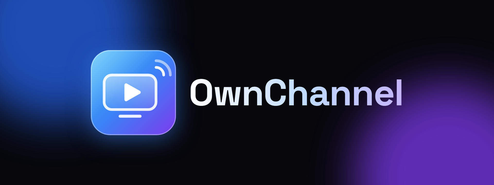

# OwnChannel

**Your own Fire TV channel in minutes.** Paste your video links, and Claude watches a few frames of each one and writes the titles, descriptions and home-screen rows. You get a branded TV app for Fire TV (Vega OS and Fire OS) from one codebase.

Built for *Build, Ship, Shape: Amazon Developer Hackathon 2026*, Fire TV track.

## Why

- **Vega OS does not run Android apps.** Every Fire TV app has to be rebuilt for it, and small creators have no way to do that.
- **Creators already have the videos.** Churches, gyms, schools, coaches and indie studios host MP4s on their own CDN, but getting onto a TV means agency builds or OTT platforms priced for media companies.
- **Metadata is the hidden work.** A TV catalog needs titles, descriptions, categories, ratings and posters for every video. OwnChannel generates all of it.

## How it works

```
creator's MP4 links ──> OwnChannel Studio (studio/)
                          ├─ ffprobe: duration
                          ├─ ffmpeg: 3 frames per video
                          ├─ Claude (vision): title, description, row, genres, rating, best frame as poster
                          └─ writes c/<channel>/catalog.json + channel.json
                                         │
node studio/brand.mjs <channel> ─────────┤ name + brand color -> packages/shared-ui/src/channel.ts
                                         ▼
TV app (apps/vega for Vega OS, apps/expo-multi-tv for Fire OS and web)
  reads catalog.json at launch, one home row per category
```

- **The catalog is remote.** Creators add videos in the studio and the TV picks them up on the next launch, with no new app build.
- **Republishing is incremental.** Only new URLs are processed. Videos already in the catalog keep their metadata.
- **AI is optional.** Without an API key, titles come from file names, so the pipeline still works offline.

## Run it

Requirements: Node 22+, Yarn 4 (via `corepack enable`), `ffmpeg`/`ffprobe` on PATH.

```bash
yarn install

# 1. Studio (creator dashboard) on http://localhost:4310
cd studio
echo "ANTHROPIC_API_KEY=..." > .env   # optional: AI metadata
npm start
#    Open the page, click "Load sample videos", then "Build my channel".

# 2. Brand the TV app with that channel
node studio/brand.mjs starlight-science-club

# 3. Run the TV app
yarn dev:web     # browser preview on http://localhost:8082
yarn build:vega  # Vega OS (see TEMPLATE_README.md for the Vega SDK and simulator)
```

`PUBLIC_BASE_URL` sets the address the TV uses to download the catalog and posters. Default: this machine's LAN IP and port 4310.

The output in `studio/public/c/<slug>/` is static, so any static host serves it. The demo channel lives on GitHub Pages (branch `gh-pages`): [catalog.json](https://netocondeantonio-commits.github.io/ownchannel/c/starlight-science-club/catalog.json). To publish your own, start the studio with `PUBLIC_BASE_URL=https://<user>.github.io/<repo>`, build the channel, and copy `studio/public/c/<slug>/` to `c/<slug>/` on that branch.

Running the Vega SDK and the Vega Virtual Device on Windows: `scripts/setup-vega-wsl.sh` (WSL2 Ubuntu 24.04, unofficial).

## Tests

```bash
cd studio && npm test
```

## Credits and licenses

- Based on [AmazonAppDev/react-native-multi-tv-app-sample](https://github.com/AmazonAppDev/react-native-multi-tv-app-sample) (MIT-0). Its original README is in `TEMPLATE_README.md`.
- Demo videos: public-domain NASA footage from [images.nasa.gov](https://images.nasa.gov). No NASA endorsement is implied.
- License: MIT-0 (see `LICENSE`).
